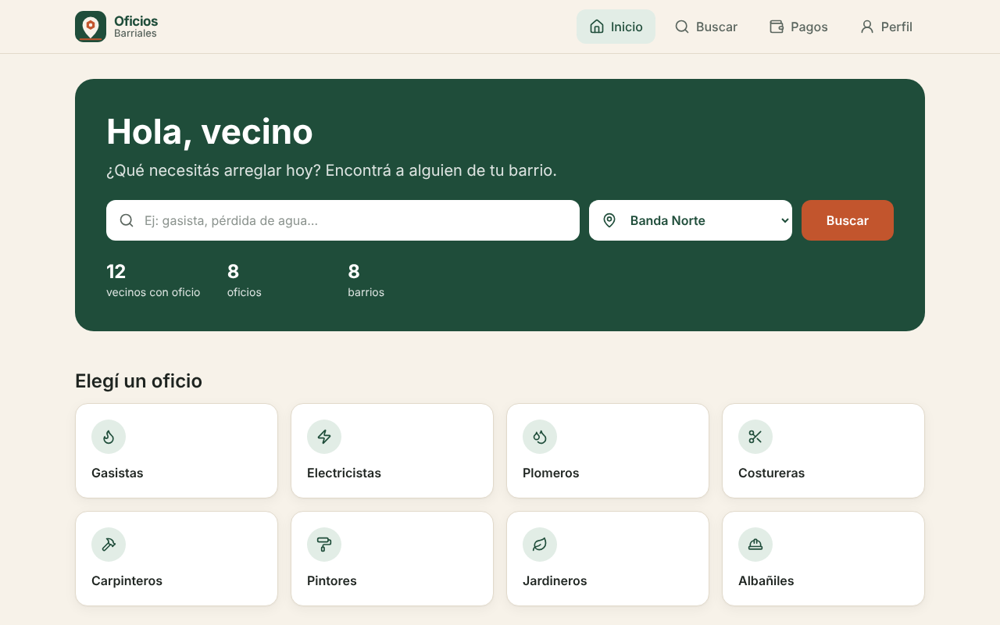
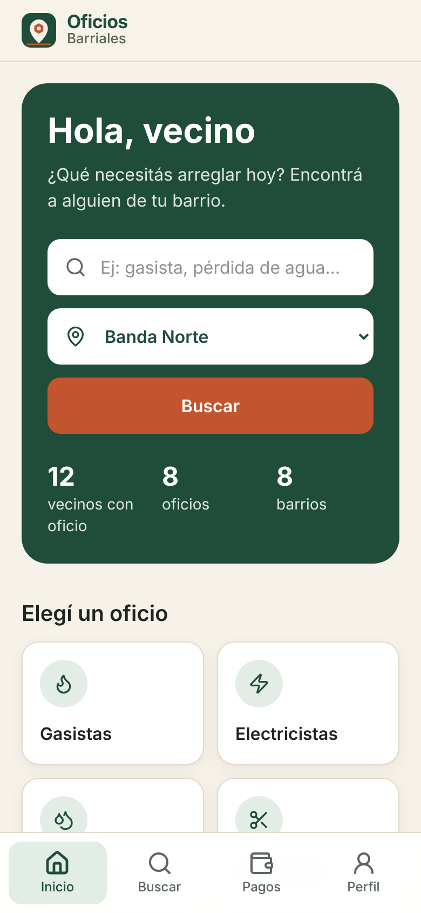

<p align="center">
  
</p>

<h1 align="center">Oficios Barriales</h1>

<p align="center">
  Encontrá gasistas, electricistas, plomeros, costureras y otros oficios de tu barrio.<br />
  Aplicación web hecha con React, pensada para Río Cuarto, Córdoba.
</p>

<p align="center">
  
  
  
  
</p>

<p align="center">
  
  
</p>

## Índice

- [Sobre el proyecto](#sobre-el-proyecto)
- [Funcionalidades](#funcionalidades)
- [Tecnologías](#tecnologías)
- [Cómo ejecutarlo](#cómo-ejecutarlo)
- [Estructura del proyecto](#estructura-del-proyecto)
- [Rutas](#rutas)
- [Datos y almacenamiento](#datos-y-almacenamiento)
- [Diseño](#diseño)
- [Limitaciones y próximos pasos](#limitaciones-y-próximos-pasos)

## Sobre el proyecto

Conseguir a alguien de confianza para un arreglo en casa suele depender del boca a boca, y los trabajadores independientes no tienen un lugar donde mostrarse. **Oficios Barriales** conecta a vecinos que necesitan un servicio con vecinos que tienen un oficio, con contacto directo por teléfono o WhatsApp.

La interfaz usa botones grandes y textos simples, para que también sea cómoda para personas mayores.

> Es un prototipo con datos ficticios, hecho con fines educativos. No usa servidor ni base de datos.

## Funcionalidades

| Sección | Qué permite |
|---|---|
| **Inicio** | Buscador de texto, selector de barrio, 8 oficios, vecinos mejor valorados y acceso al trueque |
| **Buscar** | Directorio con filtros por oficio, barrio, texto, matrícula y trueque, ordenado por calificación |
| **Ficha del vecino** | Descripción, experiencia, disponibilidad, formas de pago, opiniones con estrellas, y botones para llamar o escribir por WhatsApp |
| **Trueque** | Vecinos que cambian su trabajo por otro oficio, con propuesta directa por WhatsApp |
| **Pagos** | Pago simulado a un vecino con monto, detalle y medio de pago; genera un comprobante e historial |
| **Perfil** | Elección entre **empleado** (publica su oficio y ve pedidos de trabajo) y **empleador** (publica y administra pedidos) |

### Detalles

- **Oficios:** gasista, electricista, plomero, costurera, carpintero, pintor, jardinero y albañil.
- **Barrios:** Banda Norte, Alberdi, Las Delicias, Fénix, Bimaco, Obrero, Villa Golf y Macrocentro.
- **Pagos:** solo se ofrecen los medios que acepta cada vecino (efectivo, transferencia o Mercado Pago). No se mueve dinero real.
- **Opiniones:** cualquier persona puede dejar una; el promedio se recalcula al instante.
- **Insignias:** "Matrícula al día" y "Acepta trueque".

## Tecnologías

- [React 18](https://react.dev/) para la interfaz
- [Vite 5](https://vitejs.dev/) como servidor de desarrollo y compilador
- [React Router 6](https://reactrouter.com/) con `HashRouter`, para navegar sin configurar el servidor
- [Tailwind CSS 3](https://tailwindcss.com/) para los estilos
- [lucide-react](https://lucide.dev/) para los íconos
- `localStorage` para guardar los datos en el navegador

## Cómo ejecutarlo

Necesitás [Node.js](https://nodejs.org/) 18 o superior.

```bash
# 1. Clonar el repositorio
git clone https://github.com/MateeGonzaa/efiInterfaz.git
cd efiInterfaz

# 2. Instalar las dependencias
npm install

# 3. Iniciar el servidor de desarrollo
npm run dev
```

Abrí la dirección que muestra la terminal (normalmente `http://localhost:5173`).

| Comando | Qué hace |
|---|---|
| `npm run dev` | Inicia el servidor de desarrollo |
| `npm run build` | Genera la versión final en la carpeta `dist` |
| `npm run preview` | Prueba localmente la versión generada |

## Estructura del proyecto

```
├── index.html
├── package.json
├── tailwind.config.js        paleta y tipografía
├── vite.config.js
├── public/
│   └── favicon.svg
└── src/
    ├── main.jsx
    ├── App.jsx               rutas y títulos de página
    ├── index.css             estilos base y clases reutilizables
    ├── context/
    │   └── AppContext.jsx    estado global y guardado en el navegador
    ├── data/
    │   └── seed.js           oficios, barrios y datos de ejemplo
    ├── components/
    │   ├── Layout.jsx        barras de navegación y pie de página
    │   └── ui.jsx            logo, tarjetas, estrellas y botones de contacto
    └── pages/
        ├── Inicio.jsx
        ├── Buscar.jsx
        ├── Vecino.jsx
        ├── Trueque.jsx
        ├── Pagos.jsx
        └── MiPerfil.jsx
```

## Rutas

| Ruta | Pantalla |
|---|---|
| `/` | Inicio |
| `/buscar` | Directorio con filtros (`?oficio=`, `?q=`, `?f=`) |
| `/vecino/:id` | Ficha de un vecino |
| `/trueque` | Trueque de servicios |
| `/pagos` | Pagos de servicios |
| `/mi-perfil` | Perfil de empleado o empleador |

## Datos y almacenamiento

Los datos de ejemplo (12 vecinos con reseñas y 6 pedidos de trabajo) están en `src/data/seed.js`. Todo lo que crea cada persona se guarda en su propio navegador, con estas claves de `localStorage`:

| Clave | Contenido |
|---|---|
| `ob_barrio` | Barrio elegido |
| `ob_custom` | Perfiles de empleados creados |
| `ob_reviews` | Opiniones nuevas |
| `ob_usuario` | Rol y datos del usuario |
| `ob_pedidos` | Pedidos de trabajo propios |
| `ob_pagos` | Historial de pagos |

Para empezar de cero, borrá los datos del sitio desde las herramientas del navegador.

## Diseño

| Color | Hex | Uso |
|---|---|---|
| Bosque | `#1F4D3A` | Color principal |
| Terracota | `#C2552D` | Acciones destacadas y trueque |
| Verde llamada | `#16803F` | Botones de contacto |
| Menta | `#E2EDE6` | Fondos de tarjetas |
| Crema | `#F7F2E9` | Fondo general |

- **Tipografía:** Inter, con texto base de 18 px.
- **Logo:** un pin de barrio con una tuerca, que une "oficio" con "en tu barrio".
- **Responsive:** menú inferior en celulares, menú superior en computadoras, y listados de 1 a 3 columnas.
- **Accesibilidad:** botones de al menos 52 px, foco visible, etiquetas para lectores de pantalla y respeto por la preferencia de reducir animaciones.

## Limitaciones y próximos pasos

- [ ] Servidor y base de datos para compartir la información entre personas
- [ ] Pagos reales con Mercado Pago
- [ ] Inicio de sesión y verificación de identidad
- [ ] Opiniones permitidas solo a quienes contrataron al vecino
- [ ] Fotos de trabajos realizados y mapa de barrios
- [ ] Notificaciones de nuevos pedidos

## Aviso

Todos los nombres, teléfonos, opiniones y pedidos son ficticios y se incluyen solo con fines demostrativos.